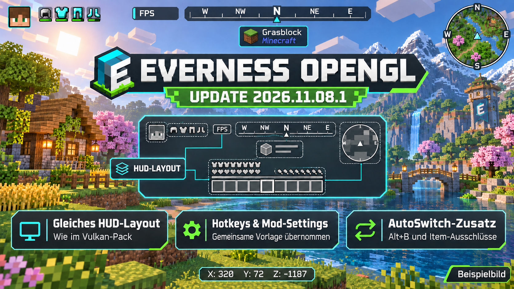

# Everness Opengl – 2026.11.08.1

HUD, Hotkeys und gemeinsame Mod-Einstellungen entsprechen der Vulkan-Vorlage.

[Änderungsnotizen](CHANGELOG.md) · [Tatsächlicher Prüfstand und Grenzen](PACK-STATUS.md) · [Einstellungen übernehmen](SETTINGS.md)

## Installieren

- [Prism-Starter herunterladen](downloads/Everness-opengl-Prism-Starter.zip), als Instanz in Prism importieren und Java 25 verwenden.
- Bei bestehender Installation das Pack aktualisieren. Für den vollständigen Einstellungsabgleich zusätzlich das [Einstellungspaket](downloads/Everness-opengl-Einstellungen.zip) einmal mit Sicherung anwenden; [Anleitung](SETTINGS.md).
- Das aktuelle Pack enthält **67 Mods, 29 Ressourcenpacks und 19 Shaderarchive**. [Alle Downloads und Quellen](MODLIST.md).

## Gemeinsame Bedienung

HUD, Jade, Minimap, FOV, Vollbild, Ressourcenpack-Reihenfolge, Punchy-Profil und QoL-Optionen stammen aus derselben Vulkan-Vorlage. **Alt+B** schaltet AutoSwitch um; Tastenkombination und Item-Ausschlüsse sind im Modmenü einstellbar. **Ziffernblock \*** schaltet den Shader, **Ziffernblock +** lädt ihn neu, **O** öffnet die Shaderauswahl. Die Bezeichnungen der Shader-Funktionen werden jeweils an Iris bzw. Vitrail angepasst.

## Grafikkomponenten

OpenGL mit Iris 1.11.7 und Voxy 0.2.20-beta. Nvidium und OBE bleiben rendererbezogene Ergänzungen. Die gemeinsame Mod-Basis, der Kartenclient sowie die vier gemeinsamen Shader entsprechen dem Vulkan-Pack. Zusätzliche vorhandene OpenGL-Shader bleiben verfügbar.

100 % Render-Skalierung ist der veröffentlichte Standard. Ein erfolgreicher Offline-Lauf belegt keine allgemeine Absturzfreiheit. **Zusätzliche native Startabbrüche wurden beobachtet und bleiben offen**; Details und einzelne Ergebnisse stehen im [Prüfbericht](PACK-STATUS.md). Es wurde kein Multiplayer-Server betreten.

Persönliche Konten, Welten, Karten-/LOD-Caches und Logdateien sind nicht enthalten. Lizenzen und Quellen: [THIRD-PARTY.md](THIRD-PARTY.md).
